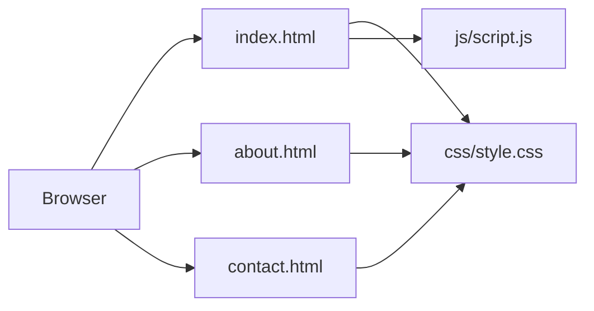

# MainCrafts Multi-Page Site

<strong>A small static multi-page website created for the MainCrafts internship Task 2.</strong>

HTML · CSS · JavaScript

## Live demo

[Open the MainCrafts multi-page demo](https://kalyan870.github.io/maincrafts-site/)

This is a static internship exercise. Example contact information is part of the sample content; its contact form has no backend and does not submit messages.

## Project overview

The site is organized into three pages: home, about, and contact. Shared styles live in `css/style.css`, and browser interactions live in `js/script.js`.

## Architecture

## Run locally

Open `index.html` in a browser, or serve the repository root with a local static-file server. No package installation, API server, or database is required by the current files.

## Project structure

- `index.html` — home page
- `about.html` — about page
- `contact.html` — contact page
- `css/style.css` — shared styles
- `js/script.js` — page interactions

## Scope

This repository is a static frontend exercise. Any form or contact action should be checked in the browser before relying on it; there is no backend service in the repository to deliver or store form submissions.
